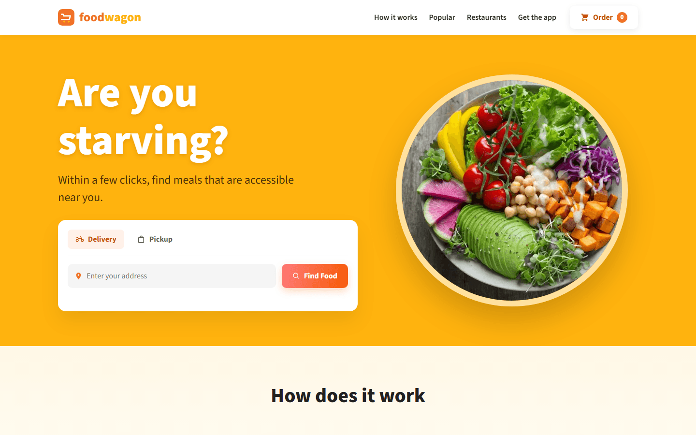

# Food Wagon – food delivery landing page

[](https://codelady-ship.github.io/Food-Wagon-delivery-figma/)

A responsive food delivery landing page built with plain HTML, CSS and JavaScript from the free **"Food Wagon" Figma community design** (orange and yellow, rounded cards).

> AZ: Figma dizaynı əsasında hazırlanmış, yemək çatdırılması üçün responsiv landing səhifə (HTML/CSS/JS).



## Features

- Hero with **Delivery / Pickup** tabs and an address search with validation.
- "How does it work" section with four steps.
- **Popular items** rendered from a JS array, with a live **text search** and **category filter** (Italian, Burgers, Asian, Chicken, Healthy, Desserts, Drinks).
- "Order now" adds to a demo order counter with a toast message.
- Featured restaurants with discount badges, ratings and open/closed status.
- App download call to action and a footer with in-page links.
- Mobile hamburger menu (keyboard and `Esc` support), skip link and visible focus styles.
- SEO: title, meta description, canonical, Open Graph/Twitter tags, favicon, `robots.txt` and `sitemap.xml`.
- Optimised WebP images (all under 90 KB).

Restaurant names, prices and ratings are sample content for the portfolio. Photos are from [Unsplash](https://unsplash.com).

## Tech stack

HTML5, CSS3 (Grid, Flexbox, custom properties, media queries), vanilla JavaScript. No build step and no dependencies.

## Run locally

```bash
git clone https://github.com/codelady-ship/Food-Wagon-delivery-figma.git
cd Food-Wagon-delivery-figma
npx serve .          # or open index.html directly in the browser
```

## Deployment

GitHub Pages serves the `main` branch from the repository root. Every push to `main` is published at
https://codelady-ship.github.io/Food-Wagon-delivery-figma/. The old address `foodvaqon.html` redirects to the new root page.

## What I learned

- Turning a Figma design into a responsive layout with CSS Grid and a few breakpoints (1100, 900 and 560 px).
- Rendering cards from data and combining a text search with category filters in vanilla JS.
- Accessible patterns: `aria-expanded` on the menu toggle, `aria-pressed` on filter chips, live regions for messages.
- Image optimisation: converting photos to WebP and setting `width`/`height` to avoid layout shift.
