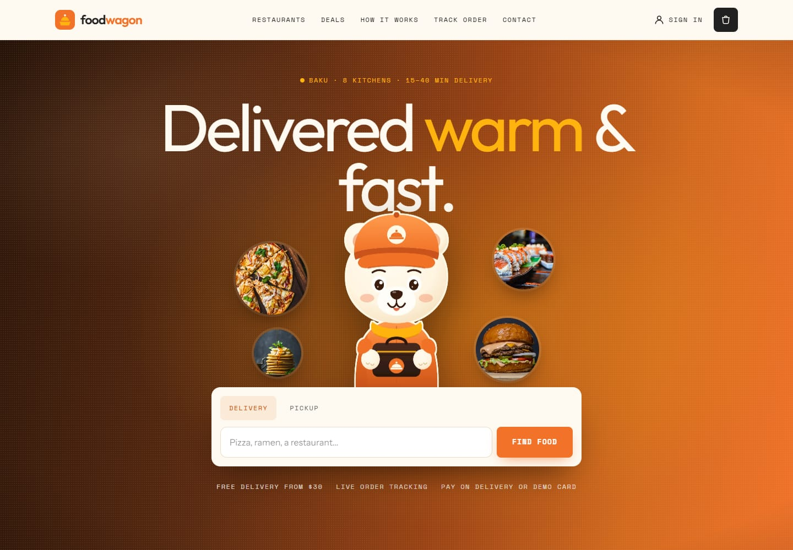

# Food Wagon – full-stack food delivery demo

[](https://codelady-ship.github.io/Food-Wagon-delivery-figma/)

Food Wagon is a demo food delivery web app for Baku. Search 8 local (sample) restaurants, add dishes to a cart,
check out, track the order live, keep favourites and write reviews. An admin panel manages restaurants, menus,
orders and promo codes. It started as a Figma practice page and was rebuilt in 2026 as a full-stack project.

> **AZ:** Food Wagon – Bakı üçün demo yemək çatdırılması saytıdır (portfolio layihəsi). Restoranları axtarmaq və
> filtrləmək, səbət, sifariş və sifarişin canlı izlənməsi, hesab, sevimlilər, rəylər, promo kodlar və admin panel var.
> Frontend: React + TypeScript + Tailwind (Vite), backend: Node.js + Express + MongoDB. API əlçatan olmayanda sayt
> daxili demo məlumatla işləyir. Heç bir real sifariş və ödəniş yoxdur.



## What works

| Area | Details |
| --- | --- |
| Interactive hero | Character cut-out over a CSS backdrop (deep coffee brown → caramel orange, vignette, ambient light). The pointer tilts the character, moves the headline and food chips at different depths and moves the light; eased every frame, back to idle when the pointer leaves. Sprite-sheet scrubbing is built in (`SPRITE.frames`). Still under `prefers-reduced-motion`. |
| "Most loved" orbit menu | Owner-supplied `DishOrbitCarousel` (GSAP ScrollTrigger): scroll-pinned plates swing on an orbit. Data from `GET /api/dishes?featured=true`, "Order food" adds to cart, likes go to `POST /api/dishes/:slug/like`. Page scroll never loops; reduced motion shows a plain list. |
| Search and filters | Text search (restaurant, cuisine or dish name), cuisine, price level, minimum rating, maximum delivery time, open now (Baku time), deals, six sort orders. Filters live in the URL. |
| Restaurant page | Menu by category, opening hours, fees, reviews, rating form, favourite button, Restaurant + Menu JSON-LD. |
| Cart and checkout | Quantities, promo codes (`WELCOME10`, `FREESHIP`, `BIG5`), delivery or pickup, validation with field messages, demo card or cash. The server prices every order again. |
| Order tracking | `FW-XXXXXX` reference, status timeline that moves on its own (demo) or by admin, refresh every 15 s, recent orders remembered. |
| Accounts | Register / sign in (JWT, bcrypt), My orders, favourite restaurants, one review per restaurant. |
| Admin | Stats, orders (status, delete), restaurants, menu and promo code CRUD with image upload, messages and newsletter subscribers. |
| Newsletter and contact | Stored in MongoDB; visible in the admin panel. |
| Demo fallback | If `VITE_API_URL` is empty, the API is down or slower than 8 s, the same routes are answered in the browser from `backend/data/seed.json` (changes saved in localStorage). A small note says "Demo mode". Demo admin: `admin@foodwagon.demo` / `demo-admin` (or the **Demo admin** button on `admin.html`). |
| Public demo admin | `admin@foodwagon.demo` / `demo-admin` is public on purpose. On the live API it is seeded by `npm run seed` (and on start) with the role `demo`: it can open every admin page, but every write answers 403 "Demo admin is read-only" (shown as a toast), also for reviews and favourites. It never sees personal data: names, phones, emails, addresses, notes and message text are replaced on the server by fixed placeholders (`backend/src/lib/demo.js`, deny-by-default: an admin GET that is not listed there answers 403 for this role), and orders are never attached to the shared account. In the browser fallback it edits a local sandbox with fictional sample orders and a **Reset demo data** button. Turn it off with `DEMO_ADMIN=false`: the demo login is refused, demo tokens issued earlier are rejected at once, and the account is deleted on the next start or `npm run seed`. |
| SEO / GEO | Titles, descriptions, canonical, Open Graph, sitemap, robots, JSON-LD (Organization, WebSite + SearchAction, FAQPage, Restaurant), static FAQ and "About" copy in the HTML, `llms.txt`. |
| Accessibility | Skip link, landmarks, one h1 per page, labelled controls with linked error messages, focus styles, 44 px touch targets, keyboard-friendly carousel, reduced motion. |

## Structure

```
frontend/   React 19 + TypeScript + Tailwind CSS 4 (Vite multi-page build, shadcn-style components/ui)
backend/    Node.js + Express 5 + Mongoose (MongoDB), zod validation, helmet, rate limits, supertest tests
backend/shared/catalog.mjs   business rules shared by the API and the demo fallback (search, pricing, promo, status)
backend/data/seed.json       demo data (8 restaurants, 36 dishes, promos, reviews)
render.yaml                  Render blueprint for the API
.github/workflows/pages.yml  builds frontend/ to GitHub Pages and runs the API tests
docs/screenshots/            1920 / 1440 / 768 / 390 screenshots of every page and hero states
```

## Run locally

```bash
# API with a throwaway in-memory MongoDB (no install needed)
cd backend
npm install
npm run dev:memory            # http://localhost:4000, admin admin@foodwagon.local / admin12345

# or against your own MongoDB
cp .env.example .env          # fill MONGODB_URI, JWT_SECRET, ADMIN_EMAIL, ADMIN_PASSWORD
npm run seed && npm run dev

# site
cd ../frontend
npm install
echo VITE_API_URL=http://localhost:4000 > .env.local   # leave out to use demo data only
npm run dev                   # http://localhost:5173
```

Tests: `cd backend && npm test` (12 suites with supertest on an in-memory MongoDB).
Build: `cd frontend && npm run build` (type-check + Vite build into `frontend/dist`).

## API overview

| Method | Path | Notes |
| --- | --- | --- |
| GET | `/api/health` | `{ ok, db }` |
| GET | `/api/meta` | categories, sorts, statuses |
| GET | `/api/restaurants` | `q, cuisine, price=1,2, minRating, maxDelivery, openNow, deals, sort` |
| GET | `/api/restaurants/:slug` | restaurant + dishes + reviews |
| POST | `/api/restaurants/:slug/reviews` | user; `{ rating 1-5, comment }`, one per user (updates) |
| GET | `/api/dishes` | `cat, restaurant, q, popular, featured` |
| POST | `/api/dishes/:slug/like` | `{ action: "like" \| "unlike" }` |
| POST | `/api/promos/validate` | `{ code, subtotal }` |
| POST | `/api/orders` | items, mode, name, phone, address, promoCode, payment; priced on the server |
| GET | `/api/orders/:reference` | public tracking (no personal data) |
| POST | `/api/auth/register`, `/api/auth/login` | returns `{ token, user }` |
| GET | `/api/auth/me`, `/api/me/orders`, `/api/me/favourites` | user |
| PUT/DELETE | `/api/me/favourites/:slug` | user |
| POST | `/api/newsletter`, `/api/contact` | public, rate limited |
| * | `/api/admin/...` | admin: stats, orders, restaurants, dishes, promos, messages, subscribers, uploads |

Security: helmet headers, CORS allow-list from `CORS_ORIGINS`, global and per-route rate limits, zod validation on
every write, bcrypt password hashes, JWT (7 days), admin-only routes, 50 KB JSON limit, image uploads limited to
WebP/JPEG/PNG/AVIF ≤ 800 KB and stored in MongoDB (Render's free disk is not persistent).

## Deploy

1. **Database**: create a free MongoDB Atlas M0 cluster, a database user and allow access from anywhere (`0.0.0.0/0`); copy the connection string.
2. **API on Render**: New → Blueprint → this repo (uses `render.yaml`). Fill `MONGODB_URI`, `ADMIN_EMAIL`, `ADMIN_PASSWORD`; `JWT_SECRET` is generated. The first start seeds the data and creates the admin.
3. **Site on GitHub Pages**: Settings → Pages → Source: *GitHub Actions*. Settings → Secrets and variables → Actions → Variables → `VITE_API_URL` = your Render URL. Push to `main` (or run the workflow) to deploy.

Render's free plan sleeps after 15 minutes; the first request can take ~50 s, so the site shows demo data until the API is awake (8 s timeout).

## Credits

See [docs/CREDITS.md](docs/CREDITS.md). Portfolio / demo project: no real orders, payments or deliveries.
